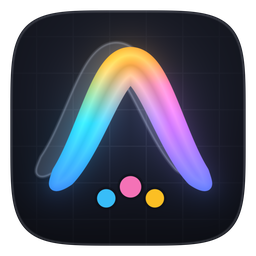
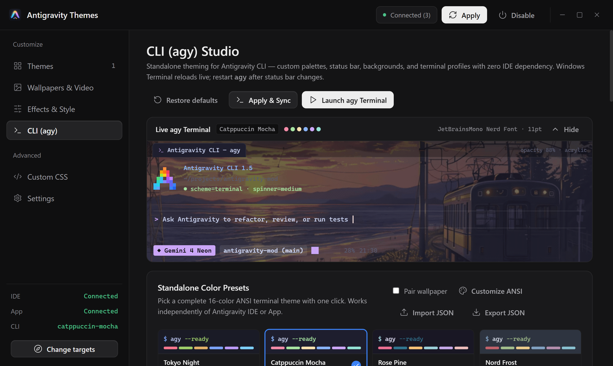
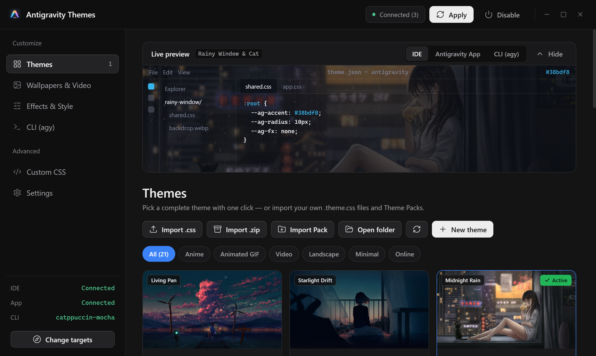
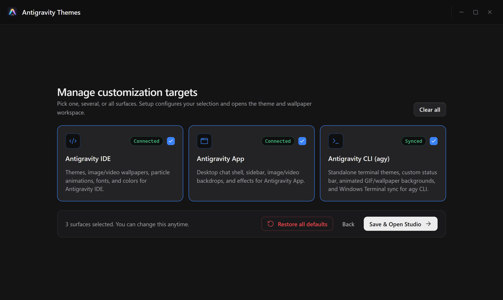

<p align="center">
  
</p>

<h1 align="center">Antigravity Themes</h1>

<p align="center">
  UI theme manager, QuickCSS editor, and standalone CLI studio for Google Antigravity IDE, App, and <code>agy</code> CLI.
</p>

<p align="center">
  <a href="https://github.com/yammdd/antigravity-mod/actions/workflows/ci.yml">
    
  </a>
  <a href="https://github.com/yammdd/antigravity-mod/actions/workflows/codeql.yml">
    
  </a>
  <a href="https://github.com/yammdd/antigravity-mod/releases">
    
  </a>
  <a href="LICENSE">
    
  </a>
  
</p>

> **Disclaimer**: Antigravity Themes is an independent, community-built, UI-only customization tool. It is **not affiliated with, endorsed by, or sponsored by Google LLC**. Google and Antigravity are trademarks of Google LLC. This tool never patches binaries, modifies `app.asar`, or touches account/telemetry data.

---

Antigravity Themes customizes Google Antigravity across three independent surfaces without patching binaries or `app.asar`:

- **Antigravity CLI (`agy`)** — Standalone terminal presets, custom 16-color ANSI editor, animated GIF / video-to-GIF backgrounds, Windows Terminal HLSL shaders, modular ANSI status bar, and one-click config sync for Windows Terminal, Ghostty, WezTerm, Kitty, and Alacritty.
- **Antigravity IDE** — Live CSS injection for `.monaco-workbench` and embedded chat over local CDP (`127.0.0.1`).
- **Antigravity App** — Live styling for `.agy-shell`, sidebar, composer, and modals.

## Preview

### Standalone CLI (`agy`) Studio
<p align="center">
  
</p>

### Theme Gallery & Live IDE Preview
<p align="center">
  
</p>

### Guided Multi-Surface Setup
<p align="center">
  
</p>

## Features

| Feature | Antigravity IDE | Antigravity App | Antigravity CLI (`agy`) |
| :--- | :---: | :---: | :---: |
| Built-in themes & media | 10 curated packs (6 × **4K UHD** Landscape/Anime, 2 × GIF, 1 × 1080p Live Video, 1 × Minimal) + 2 CSS themes | 10 curated packs (6 × **4K UHD** Landscape/Anime, 2 × GIF, 1 × 1080p Live Video, 1 × Minimal) + 2 CSS themes | 8 ANSI presets + custom 16-color editor + 3 crisp animated GIFs |
| Auto OS Dark / Light sync | `Auto (OS)` live sync via native theme events | `Auto (OS)` live sync via native theme events | Configurable Dark + Light preset pair auto-sync |
| Shareable packs & presets | `.theme.css` & single-file `.agtheme.zip` packs | `.theme.css` & single-file `.agtheme.zip` packs | Portable `.json` CLI preset export/import |
| Live QuickCSS & online CSS | Yes (`Ctrl+S` + `https://`) | Yes (`Ctrl+S` + `https://`) | — |
| Custom local fonts (`.woff2`/`.ttf`/`.otf`) | Yes | Yes | Via terminal profile |
| Image, animated GIF & video backdrops | `.jpg`, `.png`, `.gif`, `.webm`, `.mp4` (0-FPS idle pause) | `.jpg`, `.png`, `.gif`, `.webm`, `.mp4` (0-FPS idle pause) | `.jpg`, `.png`, `.gif` (+ auto `.mp4`/`.webm` → `.gif`) |
| Live dynamic animations | 12 live canvas FX (Aurora Waves, Shooting Stars, Constellation, Bokeh, Fireflies, Snow, Sakura, Rain, Ripples, Code Rain, Synthwave Grid, Stars) + Speed/Intensity + Dynamic UI motion | 12 live canvas FX + Speed/Intensity + Dynamic UI motion | Windows Terminal HLSL shaders, `runningLightSpeed`, modular `statusLine` |
| Chat polish & diagnostics | Opt-in long code block folding + live DOM selector check | Opt-in long code block folding + live DOM selector check | CLI health diagnostics & `altScreenMode` |

## Installation

### Prebuilt Binaries (Windows / macOS / Linux)

Download the latest release from [GitHub Releases](https://github.com/yammdd/antigravity-mod/releases):

| Platform | File | Notes |
| :--- | :--- | :--- |
| **Windows (x64)** | `Antigravity-Themes-<version>.exe` | Single portable executable (no installer required) |
| **macOS** | `Antigravity-Themes-<version>.dmg` | Drag to Applications |
| **Linux (x64)** | `Antigravity-Themes-<version>.AppImage` | `chmod +x` and run |

Each release includes `SHA256SUMS.txt` so you can verify file integrity (`certutil -hashfile Antigravity-Themes-1.3.0.exe SHA256` on Windows or `sha256sum -c SHA256SUMS.txt` on Linux/macOS).

> **Note on unsigned open-source builds**: Prebuilt executables are compiled directly from this repository via GitHub Actions without a paid code-signing certificate, so Windows SmartScreen or macOS Gatekeeper may prompt on first launch. You can verify the checksum against `SHA256SUMS.txt` or build locally from source.

### Run from Source (Windows / macOS / Linux)

Requires **Node.js 20+**.

```bash
git clone https://github.com/yammdd/antigravity-mod.git
cd antigravity-mod
npm install
npm run dev
```

### Scripts

```bash
npm test                # Run core 3-surface verification tests
npm run build:ui        # Build React studio UI to dist-ui/
npm run build           # Package desktop app to release/
npm run build:win       # Package Windows portable .exe to release/
```

## Surface Details

You can change active surfaces anytime using **Change targets** in the sidebar.

### Antigravity CLI (`agy`) — Standalone Studio
- Works completely independently of Antigravity IDE and App.
- Includes 8 curated 16-color terminal palettes (*Tokyo Night*, *Catppuccin Mocha*, *Rose Pine*, *Nord Frost*, *Gruvbox Dark*, *Cyberpunk Cyan*, *Dracula*, *GitHub Light*), an interactive 16-color **Customize ANSI** editor, and JSON preset import/export.
- Ships with 3 crisp built-in animated GIFs (1080p/960p) and automatic short `.mp4`/`.webm` → `.gif` conversion when `ffmpeg` is installed (`winget install Gyan.FFmpeg` / `brew install ffmpeg`).
- Configures `~/.gemini/antigravity-cli/settings.json` (`colorScheme`, `runningLightSpeed`, `altScreenMode`, and modular Node.js `statusLine` with a built-in live self-test).
- Syncs Windows Terminal (`Antigravity CLI` profile, optional default profile, and 3 built-in HLSL pixel shaders: *Subtle Vignette*, *Soft Bloom*, *CRT Scanlines*) with JSONC-safe parsing and automatic `.agthemes.bak` backup/restore.
- One-click **Write Config** (with `.agthemes.bak` backup) and copyable snippets for **Ghostty**, **WezTerm**, **Kitty**, and **Alacritty**.

### Antigravity IDE
- Setup adds `"remote-debugging-port": "0"` to `~/.antigravity-ide/argv.json`.
- Click **Launch IDE** (or restart Antigravity IDE) to attach over loopback CDP and apply live styles.

### Antigravity App
- Click **Launch App** (or start Antigravity App with `--remote-debugging-port=0`) to attach and apply live styles.

## Project Structure

```text
├── build/                 # Packaging icons (icon.ico, icon.png)
├── docs/                  # Theme authoring guide and preview screenshots
├── electron/
│   ├── assets/            # App/tray icons and Windows Terminal HLSL shaders
│   ├── core/              # Store, CDP bridge, media server, theme manager, ZIP pack, updater, CLI engine
│   ├── injector/          # CSS compiler and CSP-safe runtime DOM injector
│   ├── main/              # Electron main process, IPC handlers, IDE & OS integration
│   └── preload/           # Sandboxed contextBridge API
├── scripts/               # Core 3-surface automated test suite
├── src/                   # React + Vite desktop studio UI
└── themes/                # Bundled Theme Packs and starter .theme.css files
```

## Documentation & Policies

- [Theme Authoring Guide](docs/THEME_AUTHORING.md) — Creating `.theme.css` files and shareable `.agtheme.zip` Theme Packs
- [Contributing](CONTRIBUTING.md) — Development setup, PR checklist, and commit guidelines
- [Security Policy](SECURITY.md) — Sandbox model, loopback CDP, and vulnerability reporting
- [Changelog](CHANGELOG.md) — Release history

## License

[MIT](LICENSE)
